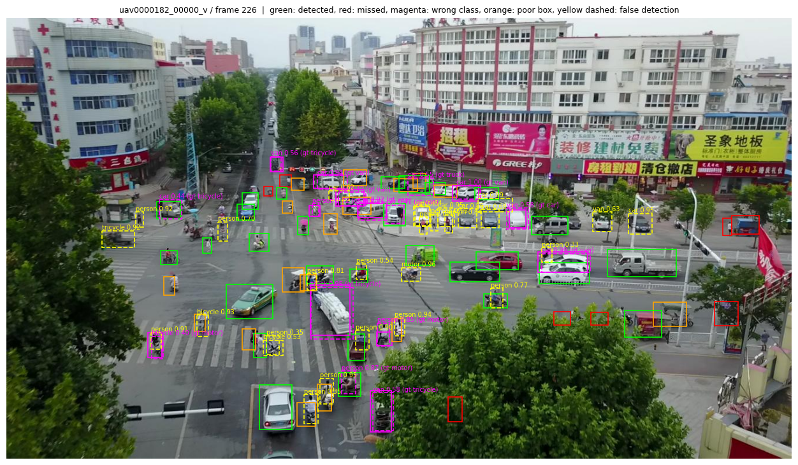

## 1. Data Understanding and Preprocessing

1. **Class distribution:** the class imbalance in our dataset is severe (car 46%, person 30%, bus 0.9%, ~50×; bus is only in 25/63 clips) -> per-class AP, focal loss.
2. **Occlusion:** val is more occluded (41% of val objects are not occluded vs 54% in train).
3. **Distribution of object sizes:** frame sizes differ -> resize to 1280 px, where 54% of objects are small (at 640 px: 89%, and 53% < 16 px). Test frames are smaller (down to 680 px) -> scale augmentation.
4. **Number of objects per frame:** max 180 objects per frame, val is denser (median 73 vs 46).
5. **How these vary across sequences:** median object size 24–87 px, density 5–150, share of car from 0 to 95% → split by clips; val has no sparse scenes.
6. **Annotation:** YOLO labels match COCO on 100% of frames.
7. **Target classes:** pedestrian + people -> person, awning-tricycle + tricycle -> tricycle, others -> ignored.
8. **Ignored regions:** in COCO each region is written 8 times (once per class), in txt once; after removing duplicates both match on 100% of frames. During training we paint them grey and drop labels covered by >=50% (only ~1% of labels). During evaluation pycocotools skips them via `iscrowd=1`.
9. **Validation:**  used the given split by clips (56 train / 7 val) and checked that no clip and no original video is in both train and val. We use this one fixed val set for all models instead of k-fold, because training each detector 5 times does not fit our GPU budget. Evaluation: pycocotools on the original val frames (every 5th, 571 frames), `maxDets=500`.
10. **Frame subsampling:** every 5th frame; the median IoU of an object with itself 5 frames later is 0.60, and 96.6% of objects are still present -> 4868 train / 571 val frames.
11. **Preprocessing:** resize to 1280 px by the longer side; normalization (ImageNet mean/std for torchvision); augmentation (flip for torchvision models, scale/mosaic/HSV for Ultralytics); seed 42, all settings in `CFG`.

## Methodology

- **Data preparation:** every 5th frame (consecutive frames are almost duplicates), frames resized to 1280 px (at 640 px most objects become < 16 px), ignored regions painted grey for training; the same preprocessed set is used by all models.
- **Validation design:** the given split by clips (no clip or video in both train and val) as one fixed hold-out set instead of k-fold, because of the GPU budget. All models are evaluated the same way: pycocotools on the original val frames, maxDets=500, ignored regions via iscrowd=1 — as on the leaderboard.
- **Models:** one detector per family, starting from COCO-pretrained weights: Faster R-CNN and RetinaNet (torchvision), YOLOv8 and RT-DETR (Ultralytics).
- **Tuning strategy:** same budget for every model (6 epochs, 1280 px, seed 42); a baseline first, then experiments that change one parameter at a time, chosen from the EDA and the error analysis (small objects, dense scenes, class imbalance). Cheap test-time settings are checked without retraining. Unsuccessful experiments are kept.
- **Main reasons:** small objects and dense scenes are the main difficulty, so the choices aim at resolution, multi-scale features and enough detections per frame.

## 2. Two-stage Anchor-based: Faster R-CNN

**Setup:** Faster R-CNN ResNet-50-FPN (torchvision `fasterrcnn_resnet50_fpn_v2`), COCO-pretrained, new head for 8 classes. Input 1280×720, up to 300 detections per image.
Training (same for all torchvision models): 6 epochs, batch 4, SGD lr 0.005, momentum 0.9, warm-up 300 iterations, lr ×0.1 after epoch 5, AMP, seed 42.

**Baseline results:** mAP 0.230, AP50 0.453, AP75 0.207, AP_small 0.116, AP_large 0.401; ~74–80 ms (~13 FPS) on T4.

- AP50 is twice bigger than mAP -> objects are found, but boxes are not accurate; mAP is on a plateau after 1–2 epochs, even though the train loss decreases.
- The best class is car (0.38), the worst is bus (0.08).

**Experiments:**

| Run | mAP | AP50 | AP75 | AP_small | AP_large | ms/img |
|---|---|---|---|---|---|---|
| Baseline | 0.230 | 0.453 | 0.207 | 0.116 | 0.401 | 74 |
| Test proposals 300 / 2000 / 3000 | 0.209 / **0.232** / 0.229 | 0.397 / 0.460 / 0.457 | – | 0.098 / 0.120 / 0.124 | – | 57 / 95 / 116 |
| RoI sampling 1024, 50% pos | 0.214 | 0.436 | 0.185 | 0.094 | 0.381 | – |
| GIoU loss (RoI head) | 0.216 | 0.436 | 0.189 | 0.103 | 0.394 | – |

- **Proposals:** after 1000 there is no significant increase.
- **RoI sampling:** worse; possibly because with a smaller share of background (75% -> 50%) the model is worse at distinguishing small objects from the background.
- **GIoU:** worse, even AP75; possibly because of the weight 10, too few epochs for a new loss function, and unstable gradients on small boxes.
- **Tuned model** = baseline + 2000 proposals at test time (0.232).
- **Leaderboard (baseline):** 0.2157.

**What each stage contributes:**

| | proposal recall (RPN) | final recall |
|---|---|---|
| small | 78.0 | 67.9 |
| medium | 88.2 | 79.4 |
| large | 99.5 | 86.3 |
| all | 87.2 | 77.7 |

The RPN filters out the background and defines which objects can be found at all; for small ones this is the bottleneck (22% lost).
The second stage classifies and refines the boxes and loses ~10 pp.; for large objects this is the main loss (misclassification).

**Failure cases:**

1. **Tiny and poorly lit objects are not found:** 37% of small objects get no detection; the smallest RPN anchor is 32 px; night light.

   

2. **Misclassification of similar classes:** car and van (668), motor and bicycle (407), rider detected as person instead of motor (394).

   

3. **False detections on unlabeled objects:** 18% of detections are background, part of which are real objects without a label.

   

4. **Occlusion:** 69% of heavily occluded objects are missed vs 13% of non-occluded.

## 3. One-stage Anchor-based: RetinaNet

**Setup:** RetinaNet ResNet-50-FPN (torchvision `retinanet_resnet50_fpn_v2`), COCO-pretrained, new classification head for 8 classes. Same input, detection limit and training protocol as Faster R-CNN.

**Baseline results:** mAP 0.188, AP50 0.361, AP75 0.172, AP_small 0.068, AP_large 0.368; 48 ms (~21 FPS) on T4.

**Anchor choice:** with default anchors (32–512) 21% of all objects and 39% of small ones have no anchor with IoU ≥ 0.4, so in training they are basically background. With 12–192 only 0.5% (1% of small) have no anchor, so we chose 12–192 for Experiment 1.

**Experiments:**

| Run | mAP | AP50 | AP75 | AP_small | AP_large |
|---|---|---|---|---|---|
| Baseline (anchors 32–512, γ=2) | 0.188 | 0.361 | 0.172 | 0.068 | 0.368 |
| Exp 1: anchors 12–192 | 0.151 | 0.346 | 0.112 | 0.060 | 0.284 |
| Exp 2: focal loss γ=1.5 | 0.185 | 0.354 | 0.174 | 0.068 | 0.374 |

- **Anchors:** worse; possibly because the finest RetinaNet level (P3, stride 8 px) is too coarse, and the pretrained model was trained with the default anchors, so each FPN level is used to certain object sizes. So Experiment 2 uses the default anchors.
- **Focal loss:** almost the same as the baseline (within epoch-to-epoch noise).
- Based on these two experiments, RetinaNet is limited by too coarse features for small objects rather than by its anchors or loss.
- **Tuned model** = baseline (0.188).

**Comparing with Faster R-CNN:**

- Overall, RetinaNet is weaker: it has no proposal stage, so there is no background filtering (it classifies ~100k anchors at once, almost all background, and focal loss only partly fixes this imbalance), each box is refined once instead of twice, and there is no P2 level.
- Faster R-CNN is better on all metrics, especially AP_small (0.116 vs 0.068); tuned Faster R-CNN: 0.232 vs 0.188.
- **Speed:** RetinaNet 48 ms / 21 FPS vs Faster R-CNN ~74–80 ms / ~13 FPS on T4. RetinaNet is faster because there is no second stage that processes each proposal.
- We can try to tackle this with focal loss, better positive sample assignment such as ATSS, a finer P2 level or higher input resolution for small objects, or anchor-free detectors like FCOS and YOLO.

## 4. One-stage Anchor-free: YOLOv8s

**Setup:** YOLOv8s (Ultralytics), COCO-pretrained. Same prepared data, 6 epochs, input 1280, flip-only augmentation, seed 42 and the same evaluation as the torchvision models. The optimiser was tuned separately: the torchvision recipe (SGD lr 0.005, batch 4) gives only 0.161 for YOLO.

**How locations are assigned without anchors:** every feature-map point (stride 8, 16, 32; plus 4 with a P2 head) predicts distances to the four box sides and a class score. The task-aligned assigner makes a point positive if it lies inside the box and is among the top 10 points by score^0.5 × IoU^6; a point inside several boxes goes to the one with the highest IoU. A 10 px object covers about one stride-8 point, so it gets very few positives; in dense scenes neighbouring objects compete for the same points, and NMS can remove overlapping boxes of the same class.

**Experiments:**

| Run | mAP | AP50 | AP_small | AP_medium | AP_large | ms/img (L4) |
|---|---|---|---|---|---|---|
| SGD lr 0.005, batch 4 (torchvision recipe) | 0.161 | 0.328 | 0.088 | 0.166 | 0.259 | 8.1 |
| AdamW auto, effective batch 64 | **0.184** | 0.361 | 0.094 | 0.175 | 0.327 | 8.4 |
| Control: AdamW 5e-4, effective batch 8 | 0.166 | 0.339 | 0.083 | 0.166 | 0.288 | 8.4 |
| Exp 1: + P2 head (stride 4) | 0.170 | 0.350 | 0.094 | 0.167 | 0.296 | 9.7 |
| Exp 2: + P2 head, input 1600 | 0.137 | 0.299 | 0.076 | 0.149 | 0.227 | 10.8 |

- **Optimiser:** the biggest effect; AdamW auto is the best YOLO (0.184).
- **P2 head:** on the same recipe AP_small grows from 0.083 to 0.094 (+14%) at +1.3 ms per frame. It works only if all pretrained weights are copied into the new graph; loading by layer index (219/437 tensors) gives 0.161.
- **Input 1600:** worse, probably because the prepared frames are already 1280 px, so training at 1600 only upscales them (blurry), while evaluation uses sharp original frames.

**Comparing with anchor-based detectors:** YOLO is below Faster R-CNN for all sizes. Against RetinaNet it has almost the same mAP but is better on small and medium objects (0.094 vs 0.068, 0.175 vs 0.165) and worse on large ones (0.327 vs 0.368). It is much faster (~8 ms), but measured on a different GPU (L4 vs T4).

## 5. Query-based: RT-DETR-L

**Setup:** RT-DETR-L (Ultralytics), COCO-pretrained, 6 epochs, AdamW lr 1e-4, effective batch 16, 300 queries (the busiest frame has 158 objects). Differences from the other models: input 1024 and default Ultralytics augmentations (mosaic off in the last 2 epochs), because DETR models learn poorly with flip only.

**Bipartite matching:** each object is matched to exactly one query (Hungarian matching on class and box cost), all other queries are trained as "no object". So duplicates are penalised during training and no NMS is needed. At the start the matching is unstable, which makes DETR models converge slowly.

**Experiments:**

| Run | mAP | AP_small | AP_medium | AP_large |
|---|---|---|---|---|
| Baseline | 0.209 | 0.096 | 0.186 | 0.388 |
| Exp 1: backbone lr 1e-5, warm-up from zero | **0.270** | 0.138 | 0.232 | 0.469 |
| Exp 2: + denoising queries 100 → 500 | 0.270 | n/a | n/a | n/a |

Exp 2: only mAP is known; its epoch-6 checkpoint was lost when Google Drive ran out of space, so the per-size metrics could not be computed.

- **Learning rates:** the biggest gain of the project (+0.061). With the default recipe the pretrained backbone is damaged at the start: the baseline begins at 0.048 and needs 4 epochs to catch up.
- **Denoising:** no gain (0.2703 vs 0.2695).
- **Convergence:** Faster R-CNN is on a plateau after epoch 1, tuned RT-DETR starts at the same level (0.207) and still improves at epoch 6, so it has not converged within the budget.
- **Small objects and dense scenes:** tuned RT-DETR is the best model for every size, including small objects (0.138 vs 0.116 for Faster R-CNN), even at a lower input resolution; 300 queries are enough for our densest frames.

## 6. Our pipeline

Start: RT-DETR exp 1 (val mAP 0.270). Inference changes use the same weights; the model change is fine-tuning.

| Step | Kind | mAP | AP_small |
|---|---|---|---|
| RT-DETR exp 1, test @1024 | start | 0.270 | 0.138 |
| test @1280 | inference | **0.286** | 0.142 |
| test @1024 + flip TTA (WBF) | inference | 0.279 | 0.140 |
| + 3 epochs fine-tuning at 1280, no mosaic | model | not scored* | not scored* |

- Testing at 1280 gives more than flip TTA; the model sees small objects with more pixels.
- *The fine-tuned weights were lost before they were scored with our evaluation (Drive ran out of space); Ultralytics' own val metric rose from 0.277 to 0.299.

**Leaderboard:**

| Submission | Public | Private |
|---|---|---|
| Faster R-CNN baseline | 0.216 | – |
| RT-DETR-L exp 2, 6 epochs, @1024 (**selected**) | **0.288** | **0.269** |
| RT-DETR-L fine-tuned at 1280 | 0.281 | 0.267 |

Fine-tuning did not help on the test set, although the Ultralytics val metric grew, so the selected submission is RT-DETR-L exp 2 (competition baseline: 0.222).

**Summary of all models (val, same evaluation):**

| Model | mAP | AP_small | AP_medium | AP_large |
|---|---|---|---|---|
| Faster R-CNN (baseline; tuned with 2000 test proposals: 0.232) | 0.230 | 0.116 | 0.216 | 0.401 |
| RetinaNet | 0.188 | 0.068 | 0.165 | 0.368 |
| YOLOv8s (AdamW auto) | 0.184 | 0.094 | 0.175 | 0.327 |
| RT-DETR-L (exp 1) | 0.270 | 0.138 | 0.232 | 0.469 |
| RT-DETR-L, test @1280 | **0.286** | 0.142 | 0.239 | 0.492 |

## 7. Final model and run instructions

- **Final model:** RT-DETR-L exp 2 (backbone lr 1e-5, transformer lr 1e-4, warm-up from zero, 500 denoising queries), 6 epochs at 1024 px, predictions at 1024 px; val mAP 0.270, public LB 0.288.
- **Order:** `00_eda_preprocessing` (builds `hw2_prepared.zip`) → `01_two_stage_faster_rcnn` → `02_one_stage_retinanet` → `03_anchor_free_yolo` → `04_query_based` (trains the final model) → `05_final_pipeline` (inference experiments and the submission file).
- **Dependencies:** Python 3, `torch`, `torchvision`, `ultralytics`, `pycocotools`, `ensemble-boxes`, `opencv-python`, `pandas`; Kaggle API token as a Colab secret.
- **Settings:** seed 42, every 5th frame, 1280 px; checkpoints are saved to Google Drive after every epoch.
