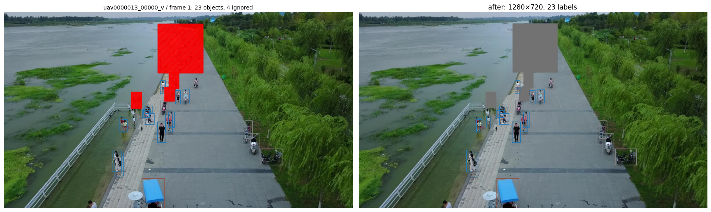
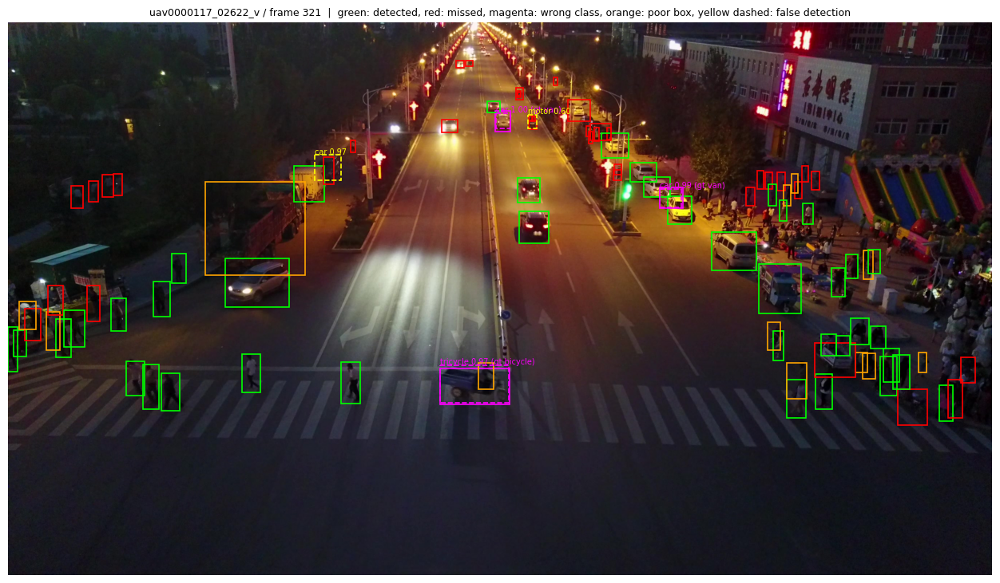
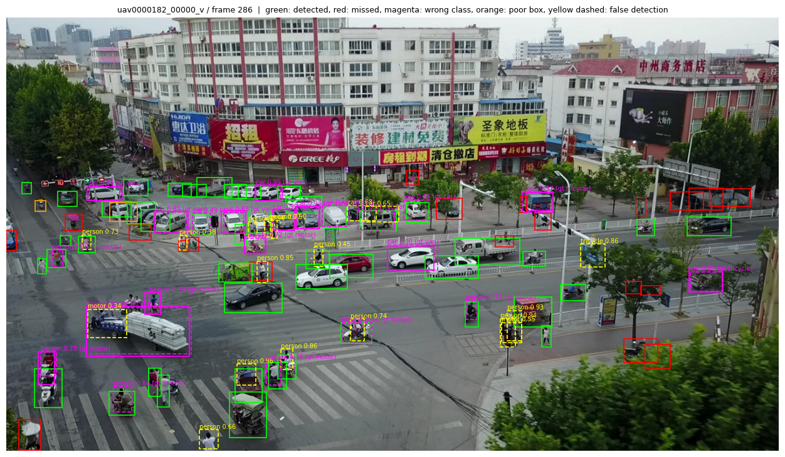

## 1. Data Understanding and Preprocessing

1. **Class distribution:** the class imbalance in our dataset is severe (car 46%, person 30%, bus 0.9%, ~50×; bus is only in 25/63 clips) -> per-class AP, focal loss.
2. **Occlusion:** val is more occluded (41% of val objects are not occluded vs 54% in train).
3. **Distribution of object sizes:** frame sizes differ -> resize to 1280 px, where 54% of objects are small (at 640 px: 89%, and 53% < 16 px). Test frames are smaller (down to 680 px) -> scale augmentation.
4. **Number of objects per frame:** max 180 objects per frame, val is denser (median 73 vs 46).
5. **How these vary across sequences:** median object size 24–87 px, density 5–150, share of car from 0 to 95% → split by clips; val has no sparse scenes.
6. **Annotation:** YOLO labels match COCO on 100% of frames.
7. **Target classes:** pedestrian + people -> person, awning-tricycle + tricycle -> tricycle, others -> ignored.
8. **Ignored regions:** in COCO each region is written 8 times (once per class), in txt once; after removing duplicates both match on 100% of frames. During training we paint them grey and drop labels covered by >=50% (only ~1% of labels). During evaluation pycocotools skips them via `iscrowd=1`.
9. **Validation:**  used the given split by clips (56 train / 7 val) and checked that no clip and no original video is in both train and val. We use this one fixed val set for all models instead of k-fold, because training each detector 5 times does not fit our GPU budget. Evaluation: pycocotools on the original val frames (every 5th, 571 frames), `maxDets=500`.
10. **Frame subsampling:** every 5th frame; the median IoU of an object with itself 5 frames later is 0.60, and 96.6% of objects are still present -> 4868 train / 571 val frames.
11. **Preprocessing:** resize to 1280 px by the longer side; normalization (ImageNet mean/std for torchvision); augmentation (flip for torchvision models, scale/mosaic/HSV for Ultralytics); seed 42, all settings in `CFG`.

## 2. Two-stage Anchor-based: Faster R-CNN

**Setup:** Faster R-CNN ResNet-50-FPN (torchvision `fasterrcnn_resnet50_fpn_v2`), COCO-pretrained, new head for 8 classes. Input 1280×720, up to 300 detections per image.
Training (same for all torchvision models): 6 epochs, batch 4, SGD lr 0.005, momentum 0.9, warm-up 300 iterations, lr ×0.1 after epoch 5, AMP, seed 42.

**Baseline results:** mAP 0.230, AP50 0.453, AP75 0.207, AP_small 0.116, AP_large 0.401; ~74–80 ms (~13 FPS) on T4.

- AP50 is twice bigger than mAP -> objects are found, but boxes are not accurate; mAP is on a plateau after 1–2 epochs, even though the train loss decreases.
- The best class is car (0.38), the worst is bus (0.08).

**Experiments:**

| Run | mAP | AP50 | AP75 | AP_small | AP_large | ms/img |
|---|---|---|---|---|---|---|
| Baseline | 0.230 | 0.453 | 0.207 | 0.116 | 0.401 | 74 |
| Test proposals 300 / 2000 / 3000 | 0.209 / **0.232** / 0.229 | 0.397 / 0.460 / 0.457 | – | 0.098 / 0.120 / 0.124 | – | 57 / 95 / 116 |
| RoI sampling 1024, 50% pos | 0.214 | 0.436 | 0.185 | 0.094 | 0.381 | – |
| GIoU loss (RoI head) | 0.216 | 0.436 | 0.189 | 0.103 | 0.394 | – |

- **Proposals:** after 1000 there is no significant increase.
- **RoI sampling:** worse; possibly because with a smaller share of background (75% -> 50%) the model is worse at distinguishing small objects from the background.
- **GIoU:** worse, even AP75; possibly because of the weight 10, too few epochs for a new loss function, and unstable gradients on small boxes.
- **Tuned model** = baseline + 2000 proposals at test time (0.232).
- **Leaderboard (baseline):** 0.2157.

**What each stage contributes:**

| | proposal recall (RPN) | final recall |
|---|---|---|
| small | 78.0 | 67.9 |
| medium | 88.2 | 79.4 |
| large | 99.5 | 86.3 |
| all | 87.2 | 77.7 |

The RPN filters out the background and defines which objects can be found at all; for small ones this is the bottleneck (22% lost).
The second stage classifies and refines the boxes and loses ~10 pp.; for large objects this is the main loss (misclassification).

**Failure cases:**

1. **Tiny and poorly lit objects are not found:** 37% of small objects get no detection; the smallest RPN anchor is 32 px; night light.

   

2. **Misclassification of similar classes:** car and van (668), motor and bicycle (407), rider detected as person instead of motor (394).

   

3. **False detections on unlabeled objects:** 18% of detections are background, part of which are real objects without a label.

   

4. **Occlusion:** 69% of heavily occluded objects are missed vs 13% of non-occluded.

## 3. One-stage Anchor-based: RetinaNet

**Setup:** RetinaNet ResNet-50-FPN (torchvision `retinanet_resnet50_fpn_v2`), COCO-pretrained, new classification head for 8 classes. Same input, detection limit and training protocol as Faster R-CNN.

**Baseline results:** mAP 0.188, AP50 0.361, AP75 0.172, AP_small 0.068, AP_large 0.368; 48 ms (~21 FPS) on T4.

**Anchor choice:** with default anchors (32–512) 21% of all objects and 39% of small ones have no anchor with IoU ≥ 0.4, so in training they are basically background. With 12–192 only 0.5% (1% of small) have no anchor, so we chose 12–192 for Experiment 1.

**Experiments:**

| Run | mAP | AP50 | AP75 | AP_small | AP_large |
|---|---|---|---|---|---|
| Baseline (anchors 32–512, γ=2) | 0.188 | 0.361 | 0.172 | 0.068 | 0.368 |
| Exp 1: anchors 12–192 | 0.151 | 0.346 | 0.112 | 0.060 | 0.284 |
| Exp 2: focal loss γ=1.5 | 0.185 | 0.354 | 0.174 | 0.068 | 0.374 |

- **Anchors:** worse; possibly because the finest RetinaNet level (P3, stride 8 px) is too coarse, and the pretrained model was trained with the default anchors, so each FPN level is used to certain object sizes. So Experiment 2 uses the default anchors.
- **Focal loss:** almost the same as the baseline (within epoch-to-epoch noise).
- Based on these two experiments, RetinaNet is limited by too coarse features for small objects rather than by its anchors or loss.
- **Tuned model** = baseline (0.188).

**Comparing with Faster R-CNN:**

- Overall, RetinaNet is weaker: it has no proposal stage, so there is no background filtering (it classifies ~100k anchors at once, almost all background, and focal loss only partly fixes this imbalance), each box is refined once instead of twice, and there is no P2 level.
- Faster R-CNN is better on all metrics, especially AP_small (0.116 vs 0.068); tuned Faster R-CNN: 0.232 vs 0.188.
- **Speed:** RetinaNet 48 ms / 21 FPS vs Faster R-CNN ~74–80 ms / ~13 FPS on T4. RetinaNet is faster because there is no second stage that processes each proposal.
- We can try to tackle this with focal loss, better positive sample assignment such as ATSS, a finer P2 level or higher input resolution for small objects, or anchor-free detectors like FCOS and YOLO.
